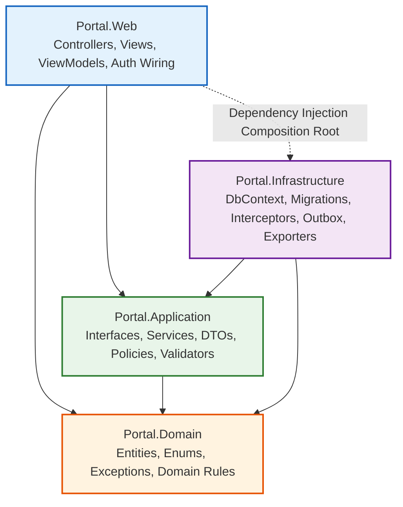
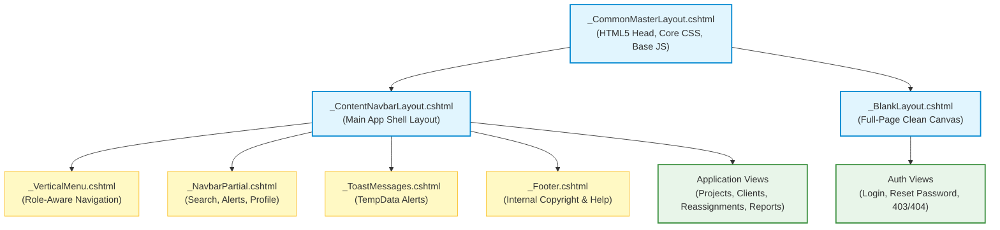
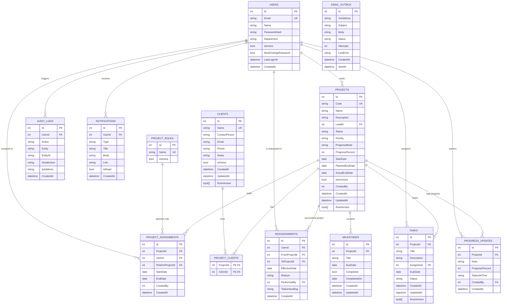
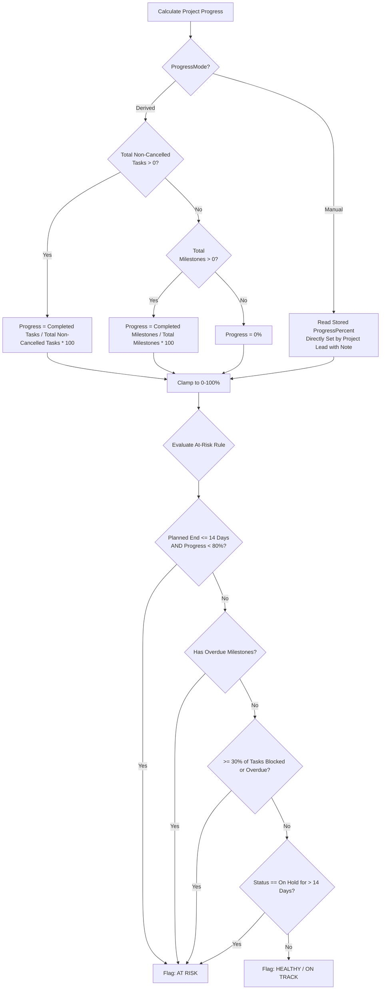

# Astra — System Architecture & Design Specification

> **Status:** Active Reference Document  
> **Source:** Derived from [`docs/project.md`](file:///c:/Users/Elyamine%20Madila/OneDrive/Documents/attain002/docs/project.md) (Build Specification) and [`docs/weeklyGoal.md`](file:///c:/Users/Elyamine%20Madila/OneDrive/Documents/attain002/docs/weeklyGoal.md) (Build Plan).  
> **Audience:** Engineering team, architects, and autonomous coding agents implementing and auditing the portal.

---

## 1. Architectural Principles & Overview

**Astra** is designed as a secure, high-integrity enterprise web portal to track client projects, staffing assignments, milestone progress, and employee mobility across projects.

### Core Architectural Principles

1. **Clean Layered Architecture (Separation of Concerns)**:
   - Clear boundaries between Web Presentation, Application Use Cases, Pure Domain Rules, and Infrastructure/Persistence.
   - Dependencies point inward toward the Domain.
2. **Server-Rendered MVC with Progressive Enhancement**:
   - Server-rendered ASP.NET Core MVC views (using Bootstrap 5 / Sneat admin layout) for predictable security, out-of-the-box CSRF token validation, and role-based UI trimming.
   - Minimal vanilla JavaScript / htmx for dynamic micro-interactions (e.g., dynamic dropdown filtering, notifications badge polling, modals) without client-side SPA complexity.
3. **Immutable & Tamper-Resistant History**:
   - Crucial business operations—specifically **Employee Reassignments**, **Progress Updates**, and **Audit Logs**—are append-only.
   - Historical records are never modified or hard-deleted; retroactive adjustments are made exclusively via compensating transactions.
   - Database-level least-privilege permissions prevent direct updates or deletes on audit tables.
4. **Strict Server-Side Authorization (Zero Trust)**:
   - Every request is authenticated by default (`FallbackPolicy`).
   - UI elements are hidden or disabled based on permissions, but the server independently verifies permissions on every request using policy- and resource-based authorization handlers.
   - Resource access prevents Insecure Direct Object References (IDOR) by returning consistent `404 Not Found` for unauthorized entity lookups and `403 Forbidden` for prohibited operations on known entities.
5. **Transactional Integrity & Concurrency Safety**:
   - Multi-step modifications (such as closing an assignment, opening a new assignment, logging reassignment history, and generating notifications) occur in a single atomic database transaction.
   - Optimistic concurrency tokens (`RowVersion`) safeguard mutable business entities (Projects, Clients, Tasks).
6. **Resilient Outbox Messaging**:
   - Notifications and emails are queued in a database outbox table within the business transaction and processed asynchronously, ensuring mail server outages never roll back business operations.

---

## 2. Technology Stack

| Component | Technology | Rationale |
|---|---|---|
| **Runtime & Framework** | .NET 8 / LTS (C# 12) | High performance, long-term support, strong typing, nullable reference types enabled. |
| **Web Presentation** | ASP.NET Core MVC (Razor Views) | Native server-side rendering, robust AntiForgery integration, simple authorization policy enforcement. |
| **UI & Styling** | Bootstrap 5.3.3 (Sneat Admin Theme) | Clean, responsive (mobile 360px to 4K desktop), accessible WCAG 2.1 AA base styling. |
| **Database** | Microsoft SQL Server | Relational integrity, filtered unique indexes, transactional ACID compliance, rowversion concurrency tokens. |
| **ORM & Data Access** | Entity Framework Core 8 | Code-first migrations, interceptors for automated audit logging, explicit query projection (`AsNoTracking`). |
| **Authentication** | ASP.NET Core Identity | Cookie-based authentication, PBKDF2 password hashing, lockout after 5 failed attempts, security stamp validation. |
| **Authorization** | ASP.NET Core Policy & Resource Handlers | Fine-grained RBAC and ABAC (e.g., checking project leadership before permitting team mutation). |
| **Document Exports** | ClosedXML & QuestPDF | High-performance, streaming generation of structured Excel (.xlsx) and printable PDF reports. |
| **Logging** | Serilog | Structured JSON logging with Correlation IDs, console and rolling file sinks. |
| **Containerization** | Docker & Docker Compose | Single-command deployment (`docker compose up`) orchestrating the ASP.NET Core web host and SQL Server. |

---

## 3. Solution Structure & Layering Boundaries

The codebase is organized into four projects within the `/src` directory, maintaining strict inward-facing dependencies:

```
/src
  ├── Portal.Domain         # Enterprise Business Rules & Entities (POCOs, Enums, Value Objects)
  ├── Portal.Application    # Application Business Rules (Services, DTOs, Handlers, Interfaces)
  ├── Portal.Infrastructure # External Concerns (EF Core, SQL Server, Email, File Exporters)
  └── Portal.Web            # Presentation Layer (MVC Controllers, Razor Views, ViewModels)
/tests
  ├── Portal.UnitTests      # Domain rule validation, calculations, service logic tests
  └── Portal.IntegrationTests # WebApplicationFactory tests with real SQL Server instance
/docs                       # Architecture, Security, Decisions, Manuals, Phase Reports
/db                         # Generated SQL scripts and seed datasets
```

### Layer Dependency Diagram



### Layer Responsibilities & Constraints

#### 1. `Portal.Domain` (Core)
* **Contents**:
  * POCO entities (`Project`, `Client`, `ProjectAssignment`, `Reassignment`, `Milestone`, `TaskItem`, `ProgressUpdate`, `AuditLog`, `Notification`, `EmailOutboxItem`).
  * Enums (`ProjectStatus`, `ProjectPriority`, `ProgressMode`, `TaskItemStatus`, `ReassignmentTaskHandling`, `OutboxStatus`).
  * Domain exceptions and invariant calculation helpers (e.g., Derived progress percentage formulas, Overdue and At-Risk predicates).
* **Boundary Rules**:
  * **ZERO** dependencies on external frameworks (no EF Core, no ASP.NET Core, no UI libraries).
  * Uses C# primitive types, `DateOnly`, and UTC `DateTime`.

#### 2. `Portal.Application`
* **Contents**:
  * Use case interfaces (`IProjectService`, `IReassignmentService`, `IProgressService`, `IClientService`, `IUserService`, `IAuditService`, `INotificationService`, `IReportExporter`).
  * Data Transfer Objects (DTOs) and ViewModels.
  * Server-side validation rules (FluentValidation or DataAnnotations).
  * ASP.NET Core Authorization requirements and resource-based authorization handlers (`ProjectLeadOrAdminHandler`, `EmployeeResourceHandler`).
  * Abstractions for external services (`IClock` / `TimeProvider`, `IEmailSender`).
* **Boundary Rules**:
  * Depends only on `Portal.Domain`.
  * Does not execute direct database queries or instantiate HTTP context objects.

#### 3. `Portal.Infrastructure`
* **Contents**:
  * `ApplicationDbContext` with fluent model configurations, table mappings, and shadow properties.
  * EF Core code-first migrations.
  * Centralized EF Core `SaveChangesInterceptor` capturing entity state mutations into structured `audit_logs`.
  * Implementations of `IEmailSender`, `INotificationService`, and `EmailOutboxProcessor` (hosted background worker).
  * Document generators: `ClosedXmlReportExporter` (.xlsx) and `QuestPdfReportExporter` (.pdf).
* **Boundary Rules**:
  * Implements interfaces defined in `Portal.Application`.
  * Encapsulates all SQL Server-specific idioms, database connections, and external I/O.

#### 4. `Portal.Web`
* **Contents**:
  * Thin MVC Controllers invoking application services.
  * Razor views (`.cshtml`), partials, and view components using the Sneat Bootstrap 5 admin theme.
  * View models ensuring strong typing and preventing over-posting attacks.
  * Middleware pipeline: Exception handling, HSTS, Security Headers, Authentication, Authorization, AntiForgery token validation.
* **Boundary Rules**:
  * Contains no business logic or direct database queries.
  * Acts as the composition root wiring dependencies via ASP.NET Core Dependency Injection.

---

## 4. UI & Presentation Architecture (Sneat Admin Integration)

The presentation layer (`Portal.Web`) leverages the **Sneat Bootstrap 5 Admin Template** as its UI system, customized to eliminate commercial bloat and tailored specifically for corporate project management.

### 4.1 Layout Hierarchy



### 4.2 Role-Aware Navigation Matrix (`_VerticalMenu.cshtml`)

The navigation bar dynamically renders menu links based on the authenticated user's role:

| Menu Section | Route / Action | Admin | Manager | Employee | Viewer |
|---|---|:---:|:---:|:---:|:---:|
| **Dashboard** | `/Dashboards/Index` | ✅ | ✅ | ✅ (Personal) | ✅ |
| **My Tasks** | `/Tasks/MyTasks` | ❌ | ❌ | ✅ | ❌ |
| **Projects** | `/Projects` (List & Filter) | ✅ | ✅ | ✅ (Assigned) | ✅ |
| | `/Projects/Create` | ✅ | ✅ | ❌ | ❌ |
| **Clients** | `/Clients` (Directory) | ✅ | ✅ | ❌ | ❌ |
| | `/Clients/Create` | ✅ | ✅ | ❌ | ❌ |
| **Staff & Allocation** | `/Workload` (Workload View) | ✅ | ✅ | ❌ | ✅ |
| | `/Employees` (Staff Directory) | ✅ | ✅ | ✅ (Self) | ✅ |
| **Reassignments** | `/Reassignments/Wizard` | ✅ | ✅ (Lead) | ❌ | ❌ |
| | `/Reassignments/Index` (History) | ✅ | ✅ | ❌ | ✅ |
| **Reports** | `/Reports` (Excel / PDF) | ✅ | ✅ | ❌ | ✅ |
| **Administration** | `/Users` (Account Management) | ✅ | ❌ | ❌ | ❌ |
| | `/ProjectRoles` (Role Lookup) | ✅ | ❌ | ❌ | ❌ |
| | `/AuditLogs` (Audit Trail) | ✅ | ❌ | ❌ | ❌ |

### 4.3 Key UI Components & Interactions

1. **Top Navbar (`_NavbarPartial.cshtml`)**:
   * **Global Search Box**: Submits GET requests to `/Projects?search=...` to query projects, clients, and staff names.
   * **In-App Notification Bell**: Polls unread notifications via an AJAX endpoint, displaying an unread dot badge and dropdown quick-view.
   * **User Profile & Secure Logout**: Displays the authenticated user's name and role badge (`Admin`, `Manager`, etc.). Logout is executed via an explicit HTTP POST form protected by `@Html.AntiForgeryToken()`.
2. **Flash Feedback Messaging (`_ToastMessages.cshtml`)**:
   * Centralized partial rendering Bootstrap 5 floating toasts for `TempData["SuccessMessage"]`, `TempData["ErrorMessage"]`, `TempData["WarningMessage"]`, and `TempData["InfoMessage"]`.
   * Automatically auto-dismisses positive notices after 4 seconds; keeps error toasts pinned until manually closed.
3. **Form Architecture & Over-Posting Defense**:
   * All mutating actions use dedicated input models / DTOs (never entity binding).
   * Forms include `@Html.AntiForgeryToken()` and validate with client-side unobtrusive validation mapped to Bootstrap 5 `is-invalid` and `invalid-feedback` states.
4. **Clean Asset Pipeline & CSP Compliance**:
   * Vendor assets (`Bootstrap 5.3.3`, `Boxicons`, `ApexCharts`, `Perfect Scrollbar`) reside locally in `wwwroot/vendor/`.
   * All external promotional links, third-party demo scripts, and CDNs are removed.
   * Inline script execution is eliminated to maintain compliance with strict `Content-Security-Policy: script-src 'self'`.

---

## 5. Domain Data Model Architecture

The data model is built on SQL Server using integer identity primary keys for high-performance indexing and foreign key constraints, coupled with concurrency tokens (`RowVersion`) on all mutable entities.

### Entity Relationship (ER) Diagram



### Critical Database Constraints & Indexing Strategy

1. **Active Assignment Uniqueness**:
   ```sql
   CREATE UNIQUE INDEX IX_ProjectAssignments_Active 
   ON project_assignments (project_id, user_id) 
   WHERE end_date IS NULL;
   ```
   *Guarantees an employee cannot hold duplicate active assignments on the same project.*

2. **Project Date Validations**:
   ```sql
   ALTER TABLE projects ADD CONSTRAINT CK_Projects_PlannedEnd 
   CHECK (planned_end_date >= start_date);

   ALTER TABLE projects ADD CONSTRAINT CK_Projects_ActualEnd 
   CHECK (actual_end_date IS NULL OR actual_end_date >= start_date);
   ```

3. **Reassignment Sanity Check**:
   ```sql
   ALTER TABLE reassignments ADD CONSTRAINT CK_Reassignments_SourceOrDest 
   CHECK (from_project_id IS NOT NULL OR to_project_id IS NOT NULL);

   ALTER TABLE reassignments ADD CONSTRAINT CK_Reassignments_DistinctProjects 
   CHECK (from_project_id IS NULL OR to_project_id IS NULL OR from_project_id <> to_project_id);
   ```

4. **Audit Trail Immutability (Least Privilege)**:
   - Application DB connection credentials are restricted to `INSERT` and `SELECT` on `audit_logs`.
   - A SQL Server trigger explicitly denies `UPDATE` or `DELETE` statements on `audit_logs`:
   ```sql
   CREATE TRIGGER TR_AuditLogs_PreventModification
   ON audit_logs
   FOR UPDATE, DELETE
   AS
   BEGIN
       SET NOCOUNT ON;
       RAISERROR ('Audit logs are immutable and cannot be updated or deleted.', 16, 1);
       ROLLBACK TRANSACTION;
   END;
   ```

---

## 6. Reassignment Workflow Architecture

Reassignment is the core business process of the portal. It coordinates five interrelated actions across assignments, audit records, task assignments, and asynchronous notifications within a single atomic database transaction.

### Reassignment Execution Sequence

```mermaid
sequenceDiagram
    autonumber
    actor Actor as Manager / Admin
    participant Web as Portal.Web (ReassignmentsController)
    participant Auth as Authorization Handler (ProjectLeadOrAdmin)
    participant Svc as Portal.Application (ReassignmentService)
    participant DB as SQL Server (ApplicationDbContext Transaction)
    participant Outbox as Email Outbox Table
    participant Worker as Background Outbox Processor
    participant Mail as SMTP Server / Email Service

    Actor->>Web: Submit Reassignment Request (Employee, FromProject, ToProject, Date, Reason, TaskHandling)
    Web->>Auth: Evaluate ProjectLeadOrAdmin(Actor, FromProject, ToProject)
    alt Unauthorized
        Auth-->>Web: Forbidden
        Web-->>Actor: 403 Forbidden / Error Message
    else Authorized
        Auth-->>Web: Success
        Web->>Svc: ExecuteReassignmentAsync(Command)
        
        rect rgb(240, 248, 255)
            Note over Svc,DB: Begin Database Transaction (IsolationLevel.ReadCommitted)
            Svc->>DB: Validate Active Assignment on FromProject
            Svc->>DB: Validate No Active Assignment on ToProject
            Svc->>DB: Validate Backdating Limit (30 days for Manager, unconstrained for Admin)
            Svc->>DB: Verify Lead Replacement if Employee is Project Lead
            
            alt Validation Failure
                Svc-->>Web: Throw ValidationException
                Web-->>Actor: Show Error Alert (Form preserved)
            else Validation Passed
                Svc->>DB: Close FromProject assignment (set end_date = effective_date)
                Svc->>DB: Open ToProject assignment (set start_date = effective_date, role)
                Svc->>DB: Handle Source Tasks (Unassign or Retain with Flag)
                Svc->>DB: Insert reassignments record (append-only)
                Svc->>DB: Insert audit_logs entry (actor, action, before/after JSON)
                Svc->>DB: Insert in-app notifications (Employee, FromLead, ToLead)
                Svc->>Outbox: Queue EmailOutboxItem records (Pending)
                Svc->>DB: Commit Database Transaction
            end
        end

        Svc-->>Web: Reassignment Completed
        Web-->>Actor: Redirect to Project Team Tab with Success Toast
        
        rect rgb(245, 245, 245)
            Note over Worker,Mail: Asynchronous Outbox Dispatch (Independent of Web Request)
            Worker->>Outbox: Poll Pending Emails
            Worker->>Mail: Send Email Notifications
            alt Dispatch Succeeded
                Worker->>Outbox: Mark Status = Sent, SentAt = UtcNow
            else Dispatch Failed
                Worker->>Outbox: Increment Attempts, Log LastError (Retry with Backoff)
            end
        end
    end
```

### Key Reassignment Invariants

1. **Source/Destination Authority Matrix**:
   * An **Admin** may perform any reassignment (any source to any destination).
   * A **Manager** may reassign an employee only if the manager leads the source project (for removals/transfers) and leads the destination project (for additions/transfers). Moving an employee from a project led by another manager requires an Admin.
2. **Atomic Guarantees**:
   * If any step fails (e.g., concurrency collision on the assignment row or database constraint violation), the transaction rolls back completely. No orphaned assignments or unsaved audit entries can exist.
3. **Timeline Reconstruction Equivalence**:
   * A point-in-time query on `project_assignments` on date $D$ (`start_date <= D AND (end_date IS NULL OR end_date > D)`) must reconstruct the exact historical team roster that is derived by traversing the `reassignments` log up to date $D$.

---

## 7. Security Architecture & Threat Mitigations

```mermaid
graph LR
    classDef client fill:#e0f7fa,stroke:#00838f,stroke-width:2px;
    classDef middleware fill:#fff8e1,stroke:#f57f17,stroke-width:2px;
    classDef endpoint fill:#e8f5e9,stroke:#2e7d32,stroke-width:2px;
    classDef storage fill:#ede7f6,stroke:#4527a0,stroke-width:2px;

    UserBrowser[User Browser]:::client
    
    subgraph ASP.NET Core Middleware Pipeline
        HSTS[Security Headers & HSTS]:::middleware
        Antiforgery[CSRF / AntiForgery]:::middleware
        AuthN[Cookie Authentication & Lockout]:::middleware
        RateLimit[Rate Limiter Login/Reset]:::middleware
        AuthZ[Deny-by-Default FallbackPolicy]:::middleware
    end

    subgraph Controller & Service Layer
        ResourceAuth[Resource Handlers<br/>ProjectLeadOrAdmin]:::endpoint
        InputVal[Validation / AntiXSS Encoding]:::endpoint
    end

    subgraph Data Layer
        ParamSQL[Parameterized SQL Queries]:::storage
        DbPerms[Least Privilege & Audit Trigger]:::storage
    end

    UserBrowser --> HSTS --> Antiforgery --> AuthN --> RateLimit --> AuthZ
    AuthZ --> ResourceAuth --> InputVal --> ParamSQL --> DbPerms
```



### Security Controls Matrix

| Threat Category | Implementation Detail | Enforced In |
|---|---|---|
| **Unauthorized Access** | `FallbackPolicy` requires authenticated user across all endpoints. Specific routes require `Admin`, `Manager`, `Employee`, or `Viewer` roles. | `Program.cs` / Authorization Configuration |
| **Cross-Site Request Forgery (CSRF)** | `AutoValidateAntiforgeryTokenAttribute` applied globally. All mutating actions strictly use HTTP POST with valid anti-forgery form tokens. | `Portal.Web` Filter Pipeline |
| **Insecure Direct Object Reference (IDOR)** | Queries returning projects, tasks, or profiles are scoped to the caller's role and assignments. Forbidden actions yield `403`; unassigned projects for Employees return `404`. | `Portal.Application` Resource Handlers |
| **Cross-Site Scripting (XSS)** | Razor views auto-encode HTML outputs. Strict Content-Security-Policy (CSP) headers without unsafe inline scripts. `Html.Raw` is forbidden on user-submitted content. | Razor Views & Middleware |
| **SQL Injection** | Exclusively parameterized queries generated by EF Core and Dapper. Raw string-concatenated SQL queries are prohibited. | `Portal.Infrastructure` |
| **Brute Force & Credential Attacks** | Identity account lockout triggered after 5 failed attempts within 15 minutes. Fixed-window rate limiting on login and password reset routes. | Identity Configuration & ASP.NET Core RateLimiter |
| **Tampering with Audit Logs** | Application database login granted only `INSERT` and `SELECT` rights on `audit_logs`. Database triggers prevent `UPDATE` or `DELETE`. | SQL Server Configuration & Migration |

---

## 8. Progress & Health Calculation Engine

Progress tracking supports dual modes configured per project:



---

## 9. Asynchronous Processing & Outbox Pattern

To maintain transaction speed and prevent email server latency or downtime from impacting portal operations, notification emails follow the Transactional Outbox Pattern:

1. **Transactional Enqueue**: During the primary business transaction (e.g., project reassignment), notification records and `EmailOutboxItem` rows are inserted with `Status = 'Pending'`.
2. **Background Dispatcher**: An `IHostedService` background worker polls the `email_outbox` table at regular intervals (default: every 15 seconds) using batch locking (`READPAST`).
3. **Execution & Backoff**:
   - The worker transmits messages via the configured `IEmailSender`.
   - On success, `Status` becomes `'Sent'` and `SentAt` is timestamped.
   - On error, `Attempts` is incremented, `LastError` is recorded, and retry is scheduled with exponential backoff.
   - Operations that fail permanently after maximum retries are logged for administrative inspection.

---

## 10. Architectural Seams for Future Extension

While the initial version intentionally avoids speculative features (budget tracking, Gantt charts, client portals, SSO, comment threads), clean architectural seams are preserved:

* **File Attachments**: Decoupled file storage interface (`IFileStorageService`) ready to plug in Azure Blob Storage or local disk without modifying project entities.
* **Comment System**: Polymorphic entity seam (`Comment(EntityType, EntityId, AuthorId, Content, CreatedAt)`) designed for future inclusion.
* **External Single Sign-On**: ASP.NET Core Identity authentication pipeline preserves standard endpoints to plug Microsoft Entra ID / Google OpenID Connect providers.
* **Full REST/GraphQL API**: Application services and DTOs in `Portal.Application` can be directly consumed by API controllers or Minimal APIs without duplicating domain logic.
